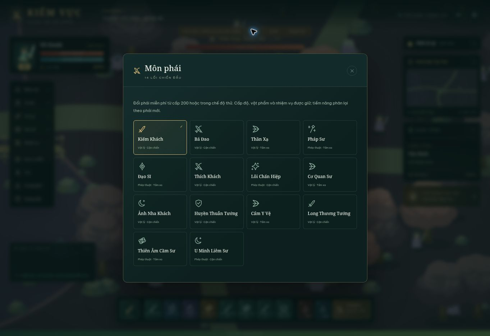

# Kiếm Vực — Giang Hồ Mở Rộng

Webgame kiếm hiệp chơi đơn bằng JavaScript và Canvas 2D. Bản v2 tích hợp thông số tham chiếu vào engine viết độc lập, kèm hình vẽ, biểu tượng, địa hình và hiệu ứng mới.

**Chơi ngay:** https://caovanhanhtp2891-lab.github.io/kiemvuc/

Chọn **Bắt đầu từ Lv1** để chơi hành trình, hoặc **Thử toàn bộ Lv400** để kiểm tra mọi phái, kỹ năng và bản đồ. Khi đang chơi, nút **Thử Lv400** nằm trên thanh đầu trang. Chế độ thử không ghi đè hành trình chính; dùng **Đổi phái**, **Bù nhìn**, rồi **Về hành trình** để quay lại.



## Nội dung đã tích hợp

| Hệ thống | Bản v2 |
| --- | --- |
| Môn phái | 14 phái, chỉ số gốc, thuộc tính chính, tầm và nhịp đánh, vũ khí vẽ riêng |
| Võ học | 112 chiêu, 8 mỗi phái; học theo cấp, nâng tối đa Lv10; nội lực và hồi chiêu riêng |
| Cấp nhân vật | 1–400, đường cong EXP, 5 điểm tiềm năng và 1 điểm kỹ năng mỗi cấp |
| Bản đồ | 48 vùng, trong đó 9 thành trấn, kích thước và danh sách sinh quái theo dữ liệu |
| Quái và boss | 146 mẫu, gồm 39 boss; chỉ số nền, tái sinh, AI, hộ thể và đòn báo trước |
| Nhiệm vụ | 86 nhiệm vụ nối tiếp; diệt quái, boss, thu thập, gặp NPC, học chiêu, rèn đồ, tổ đội |
| NPC | 15 vai trò, hiện trong thành trấn; có menu dịch vụ và dẫn đường |
| Trang bị | 10 vị trí, 35 bậc, 6 phẩm chất; mặc/tháo, bán, phân giải, kho, cường hóa +15 |
| Ngọc | 5 loại, 5 cấp; đục tối đa 3 lỗ, khảm/tháo và hợp 3 viên |
| Đồng hành | 8 thú cưng tăng chỉ số, cho ăn; 10 thú cưỡi tăng tốc; 4 thế lực |
| Hoạt động | Tổ đội tối đa 4 NPC, đấu trường NPC, phó bản 3 đợt quái + boss, truy nã |
| Tự động | Tìm quái, dùng kỹ năng và thuốc, nhặt đồ, ưu tiên mục tiêu nhiệm vụ/boss |
| Tiến trình | Tự lưu, nhập/xuất JSON, chuyển bản lưu v1, thưởng vắng mặt tối đa 8 giờ |

Các chiêu xử lý chém quạt, lướt, đạn, mưa đạn, vùng sát thương, liên hoàn, hồi phục, khiên, tăng chỉ số, triệu hồi và tuyệt kỹ. Những tham số choáng, đốt, độc, hút máu, đẩy, kéo và làm chậm được áp dụng trong chiến đấu. Buff hết hạn sẽ trả chỉ số về nền.

[Bộ dữ liệu tham chiếu](docs/chienhon/README.md) ghi nguồn, công thức và giới hạn quan sát. [Ghi chú triển khai v2](docs/implementation-v2.md) mô tả cách thử và những phần chưa có.

## Chạy trên Windows

Mở PowerShell trong thư mục dự án:

```powershell
cd dist
py -m http.server 8080
```

Mở http://localhost:8080 bằng Chrome, Edge hoặc Firefox. Có thể dùng `python` thay `py`. Không cần thư viện, API key hay tài khoản. Không mở HTML bằng `file://` để tránh khác biệt về lưu trữ của trình duyệt.

## Điều khiển

| Phím / thao tác | Chức năng |
| --- | --- |
| WASD / mũi tên | Di chuyển, tắt tự đánh |
| Nhấp / chạm đất | Đi đến vị trí |
| Nhấp / chạm quái | Chọn mục tiêu, tiếp cận và đánh |
| Space | Đánh thường |
| 1–8 | Thi triển kỹ năng |
| Q / E | Dùng thuốc máu / nội lực phù hợp cấp |
| T | Bật/tắt tự đánh |
| B / C / K / M / J / P | Túi / nhân vật / võ học / bản đồ / nhiệm vụ / thú |
| Esc | Đóng menu |

Menu tạm dừng chiến đấu. Các nút trên màn hình hỗ trợ thao tác chạm. Tab chạy nền tiếp tục cập nhật tự đánh khi trình duyệt cho phép; trình duyệt hoặc hệ điều hành có thể treo tab nên không bảo đảm chạy liên tục khi máy ngủ.

## Cấu trúc và kiểm tra

```text
dist/
  content.js   Dữ liệu 14 phái, kỹ năng, bản đồ, quái, nhiệm vụ, vật phẩm
  rules.js     Luật số liệu, chỉ số, XP, sát thương, thưởng, rèn, bản lưu
  game.js      Engine, AI, giao diện, NPC, hoạt ảnh, đồ họa và âm thanh
  index.html   Giao diện gốc
  style.css    Giao diện thích ứng
tests/
  rules.test.js
docs/
  chienhon/    JSON/CSV và phân tích tham chiếu
```

```sh
node --check dist/content.js
node --check dist/rules.js
node --check dist/game.js
node --test tests/rules.test.js
```

12 bài kiểm tra tự động bao phủ đủ 86 điều kiện và phần thưởng nhiệm vụ, tham chiếu bản đồ/quái, sát thương, EXP, trang bị/ngọc, rèn, chuyển bản lưu và túi đầy. Đã thử trực tiếp thi triển đủ 112 chiêu qua 14 phái, đi bản đồ cuối Lv400, tự đánh, nhiệm vụ boss, trả thưởng, cường hóa, đục lỗ và khảm ngọc. GitHub Actions kiểm tra cú pháp và luật chơi trước khi triển khai thư mục `dist/` lên Pages.

## Phạm vi

Đây là bản game chơi đơn tự viết dựa trên các thông số công khai đã quan sát, **không phải toàn bộ mã nguồn hoặc bản sao y nguyên Chiến Hồn**. Engine, đồ họa Canvas, lời hướng dẫn và xử lý hoạt động được viết mới; không kèm sprite/âm thanh/mã vẽ gốc. Cách bố trí cảnh, hoạt ảnh, AI, phụ bản và một số công thức bổ sung là triển khai riêng, không bảo đảm hành vi giống máy chủ gốc.

Chưa có máy chủ tài khoản, đồng bộ nhiều thiết bị, người chơi online, PK thật, chat, bang hội, bảng xếp hạng hay boss thế giới. Tổ đội và đấu trường sử dụng NPC. Bản lưu nằm trong localStorage của đúng trình duyệt và địa chỉ; nên xuất JSON trước khi xóa dữ liệu trình duyệt. Chuyển từ v1 giữ tên, cấp, tiền, trang bị tương ứng; chuỗi nhiệm vụ v2 bắt đầu lại vì cấu trúc đã thay đổi.
