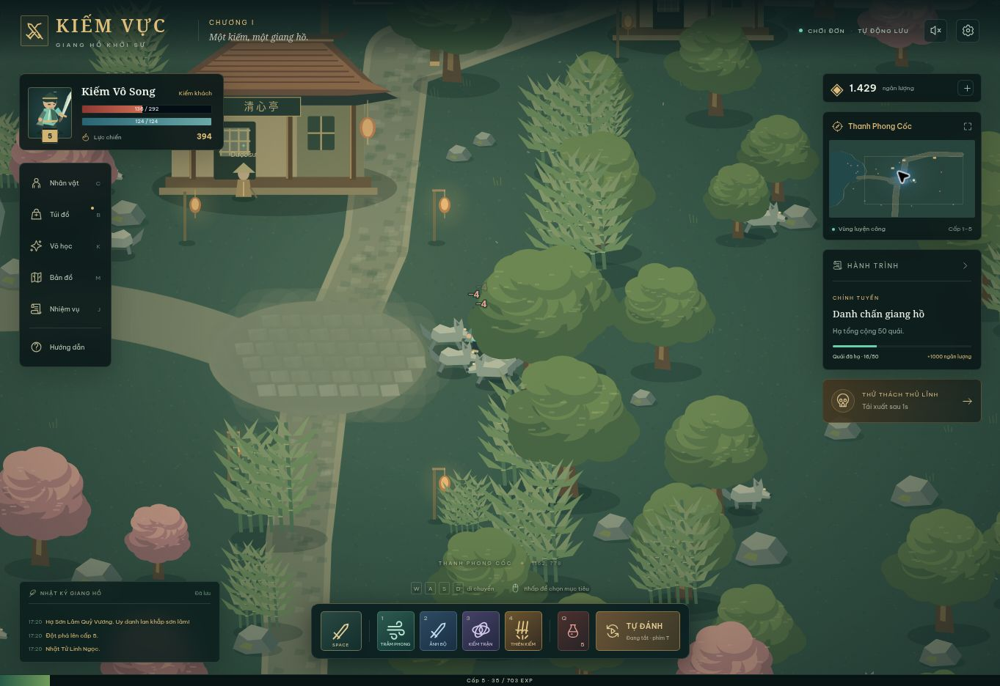

# Kiếm Vực — Giang Hồ Khởi Sự

Webgame nhập vai kiếm hiệp chơi đơn, viết bằng JavaScript, CSS và Canvas 2D. Đây là bản mẫu chơi được; toàn bộ mã, hình vẽ trong game và biểu tượng được tạo mới.

[Bộ tham chiếu thông số Chiến Hồn](docs/chienhon/README.md) gồm bảng môn phái, kỹ năng, cấp độ, bản đồ, quái, nhiệm vụ và NPC. Đây là tài liệu phân tích riêng; các tính năng đó chưa được tích hợp vào bản mẫu Kiếm Vực dưới đây.



## Chạy trên Windows

Cài Python nếu máy chưa có, mở PowerShell trong thư mục dự án và chạy:

```powershell
cd dist
py -m http.server 8080
```

Sau đó mở **http://localhost:8080** bằng Chrome, Edge hoặc Firefox. Nếu máy dùng lệnh `python`, thay `py` bằng `python`.

Game không cần cài thư viện, không cần API key và không cần tài khoản. Tiến trình được lưu trên trình duyệt và địa chỉ đang chơi. Chuyển sang trình duyệt, thiết bị hoặc địa chỉ khác sẽ dùng bộ dữ liệu riêng.

## Tính năng hiện có

- 3 môn phái: Kiếm khách, Linh pháp, Thần xạ; đòn thường cận chiến hoặc tầm xa.
- 3 vùng luyện công mở theo cấp, quái tái sinh và thủ lĩnh riêng ở mỗi vùng.
- 4 kỹ năng có nội lực và thời gian hồi chiêu.
- Tự tìm quái, chiến đấu, dùng kỹ năng, nhặt đồ và dùng bình hồi máu.
- Kinh nghiệm, lên cấp, nhiệm vụ, cửa hàng bình hồi phục và quà mỗi ngày.
- Trang bị ở 3 vị trí, 4 phẩm chất; mặc, tháo, bán và cường hóa tối đa +20.
- Bản đồ thu nhỏ, camera theo nhân vật, hiệu ứng và âm thanh chiến đấu.
- Tự lưu mỗi 5 giây; thưởng luyện công vắng mặt tối đa 8 giờ.

## Điều khiển

| Phím / thao tác | Chức năng |
| --- | --- |
| WASD / phím mũi tên | Di chuyển và tắt tự đánh |
| Nhấp hoặc chạm mặt đất | Di chuyển đến vị trí |
| Nhấp hoặc chạm quái | Tiếp cận và đánh mục tiêu |
| Space | Đánh thường |
| 1–4 | Dùng kỹ năng |
| Q | Dùng bình hồi 60% sinh lực tối đa |
| T | Bật/tắt tự đánh |
| B / C / K / M / J | Túi đồ / nhân vật / võ học / bản đồ / nhiệm vụ |
| Esc | Đóng menu |

Trên điện thoại, chạm để di chuyển và dùng thanh kỹ năng. Mở menu sẽ tạm dừng chiến đấu.

## Cấu trúc mã nguồn

```text
dist/
  index.html    Giao diện và thanh thông tin
  style.css     Bố cục, hộp thoại và giao diện thích ứng
  game.js       Luật chơi, điều khiển, lưu tiến trình và đồ họa Canvas
docs/
  kiem-vuc-gameplay.png
```

Có thể đưa nội dung `dist/` lên dịch vụ lưu trữ web tĩnh. Font Google là tùy chọn, đã có font dự phòng trên máy.

## Kiểm tra

Kiểm tra cú pháp bằng Node.js:

```shell
node --check dist/game.js
```

Đã kiểm tra trực tiếp: tạo nhân vật, tự đánh, hạ boss, nhận trang bị, lên cấp, nhận thưởng nhiệm vụ, cường hóa, mặc trang bị, mở vùng thứ hai, chuyển bản đồ và khôi phục tiến trình sau khi tải lại trang.

## Phạm vi bản mẫu

Phiên bản hiện tại chơi đơn, chưa có máy chủ nhiều người, tài khoản đồng bộ, PK hoặc bang hội. Dữ liệu dùng localStorage; xóa dữ liệu trình duyệt sẽ xóa tiến trình. Thưởng vắng mặt được tính theo đồng hồ thiết bị. Ba vùng hiện dùng chung bố cục địa hình với màu sắc, quái, cấp và phần thưởng khác nhau. Bốn kỹ năng đang mở sẵn cho cả ba môn phái để thử nghiệm.
