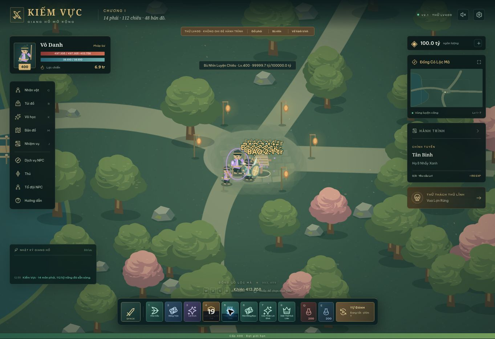

# Kiểm tra và sửa lỗi v2.1 — 04/11/2026

Bản v2 trước đó có kiểm tra dữ liệu và lượt thi triển, nhưng chưa kiểm tra đủ tác dụng của các hành động trong engine. Lượt này thêm kiểm tra tích hợp chạy trực tiếp các hàm engine và xử lý lệnh, sau đó thử trình duyệt. Không tuyên bố đã hết mọi lỗi hoặc tương đương toàn bộ máy chủ gốc.

## Các lỗi đã sửa

| Trường hợp | Trước | Sau |
| --- | --- | --- |
| Lướt đánh | Có thể đánh trúng mục tiêu cách 600 đơn vị sau khi chỉ lướt 170 | Chỉ đánh các mục tiêu nằm trên đường lướt, không cần mục tiêu để lướt di chuyển |
| Đạn kỹ năng | Đặt sẵn sát thương lên mục tiêu, chưa xét đường bay | Di chuyển theo tốc độ, hướng, độ rộng; xuyên mục tiêu hoặc nổ theo cấu hình |
| Mưa đạn | Bị cắt còn 18 đợt, mỗi đợt đánh cả vùng | Dùng đúng số viên khai báo, điểm rơi và bán kính nổ riêng |
| Tự đánh với chiêu đặt vùng | Đòi đứng gần bằng bán kính vùng dù là chiêu đặt từ xa | Chỉ chiêu quanh thân/chém quạt mới cần đứng gần |
| Buff, hồi máu, khiên | Chưa áp đủ mức tăng theo cấp kỹ năng | Áp hệ số 1 + 0,12 × (cấp kỹ năng − 1); có hồi phục theo thời gian cho chiêu hồi máu |
| Chậm và độc/cháy | Chậm luôn 3 giây; trạng thái có thể cộng vô hạn | Dùng thời lượng khai báo; tái áp làm mới từng loại trạng thái |
| Đổi phái | Các đòn đang chờ của phái trước còn tiếp tục | Xóa đòn chờ, đạn, hiệu ứng và hồi chiêu cũ |
| Cường hóa/khảm/thú cưỡi/thú cưng | Một số thao tác chờ vòng UI kế tiếp mới cập nhật chỉ số | Cập nhật chỉ số ngay khi lưu thay đổi |
| Thú cưng | Đổi rồi chọn lại bị về cấp 1 | Lưu cấp riêng từng thú; cấp 100 không tiêu thêm thức ăn |
| Trứng/thú cưỡi | Chưa chặn dùng khi thiếu cấp hoặc đã sở hữu | Kiểm tra cấp và trùng sở hữu trước khi trừ vật phẩm |
| EXP x2 | Có bán nhưng chưa dùng được | Thêm 900 giây EXP chiến đấu x2, hiện thời gian và lưu lại |
| Cửa hàng | Cho mua thú đặc biệt giá 0, Linh Hồ có nút mua trứng nhưng không có trứng | Bỏ món giá 0 khỏi bán; ghi rõ Linh Hồ là linh thú triệu hồi, thú đặc biệt có trong chế độ thử |
| Truy nã | Hợp đồng cũ không đổi ngày, thiếu dẫn đường | Đặt lại theo ngày Việt Nam và có nút tới khu mục tiêu |
| Thưởng đấu trường | Có thể tính vào quái/boss/nhiệm vụ/truy nã ngoài thế giới | Chỉ tính thắng đấu trường và thưởng của trận |
| Thưởng phó bản | Có thể làm túi vượt 150 món | Gửi vào kho khi túi đầy; cả túi/kho đầy thì rơi dưới chân |
| Túi đầy | Đồ nhặt bị tự bán mà không có lựa chọn | Để trang bị dưới đất chờ có chỗ trống |
| Tự hồi sinh khi chạy nền | Timer bị chặn bởi hộp thoại tử trận | Timer hồi sinh vẫn được cập nhật khi tự đánh |
| Khung hình chậm | Luôn cắt thời gian mô phỏng còn 0,06 giây mỗi khung, khiến game chạy chậm | Chia thời gian đã qua thành bước 0,05 giây; bù tối đa 2 giây mỗi khung để tránh treo khi quay lại |
| Quái tầm xa | Chạy sát rồi đánh cận chiến | Giữ tầm 240, bắn và gây sát thương tại điểm được báo |
| Bản lưu ngọc | Ngọc nhập vào có thể vượt số lỗ | Cắt theo số lỗ hợp lệ khi chuẩn hóa |

## Kiểm tra tự động

Chạy `node --test tests/*.test.js`: **34/34 đạt**.

- Kiểm tra luật số liệu, EXP, sát thương, bạo kích, 10 vị trí trang bị, ngọc, rèn và chuyển bản lưu.
- Mô phỏng từng chiêu trong **112 chiêu**, tắt đòn thường và đồng đội để xác nhận chính chiêu đó gây sát thương hoặc tạo tác dụng hồi máu/khiên/buff/triệu hồi.
- Kiểm tra điều kiện/phần thưởng của **86 nhiệm vụ**, và dẫn đường của từng nhiệm vụ tới map hoặc NPC hợp lệ.
- Chạy **14 hành trình cấp 1**, mỗi hành trình 120 giây mô phỏng: đủ 8 quái nhiệm vụ đầu, có lên cấp và nhân vật sống.
- Chạy qua 3 đợt phó bản + boss, xác nhận chỉ thưởng một lần và không vượt giới hạn túi.
- Xác nhận đấu trường không làm tăng mục tiêu ngoài thế giới; tự hồi sinh sau 5 giây; menu dừng chiến đấu.
- Kiểm tra hồi chiêu/đòn cũ khi đổi phái, đường lướt, xuyên đạn, tầm auto, thời lượng chậm, làm mới cháy/độc, cấp thú và thuốc x2.

Fixture Node dùng phần trình bày giả lập tối thiểu để kiểm tra engine của dự án; không phải trình duyệt thật, không đo FPS hoặc chứng minh toàn bộ đồ họa đúng.

## Kiểm tra trên trình duyệt

Đã thử hành trình Pháp Sư từ cấp 1: tự tìm quái, bắn Hỏa Cầu, nhận EXP, lên cấp, hoàn thành Tân Binh và trả thưởng để sang Nanh Lợn Rừng. Trong chế độ Lv400, Linh Quang Hộ Thể tạo khiên 413.758 trên 497.305 máu nền; Sói Con được cho ăn lên cấp 3, đổi sang Rùa rồi quay lại vẫn cấp 3; cưỡi Kim Long hiện tốc chạy 288/s; mua và dùng EXP x2 hiện 15 phút. Không ghi nhận lỗi JavaScript của ứng dụng trong lượt thử này.

## Phạm vi đối chiếu

Lần đọc lại `https://chienhon.top/` trong lượt sửa này trả HTTP 403. Phân tích cơ chế dùng bản client công khai đã quét trước đó ngày 04/11/2026 và các bảng `docs/chienhon/`. Không thử vượt hạn chế hoặc truy cập máy chủ riêng.

Dự án vẫn là bản chơi đơn tự viết. Không có mã server gốc, dữ liệu tài khoản, đồ họa/sprite/âm thanh gốc, multiplayer, chat, bang hội hoặc toàn bộ sự kiện của Chiến Hồn. Chưa chạy trọn hành trình Lv1→400 theo thời gian thực và chưa kiểm tra trên điện thoại thật. Browser/OS vẫn có thể treo tab; không bảo đảm chạy khi máy ngủ.

