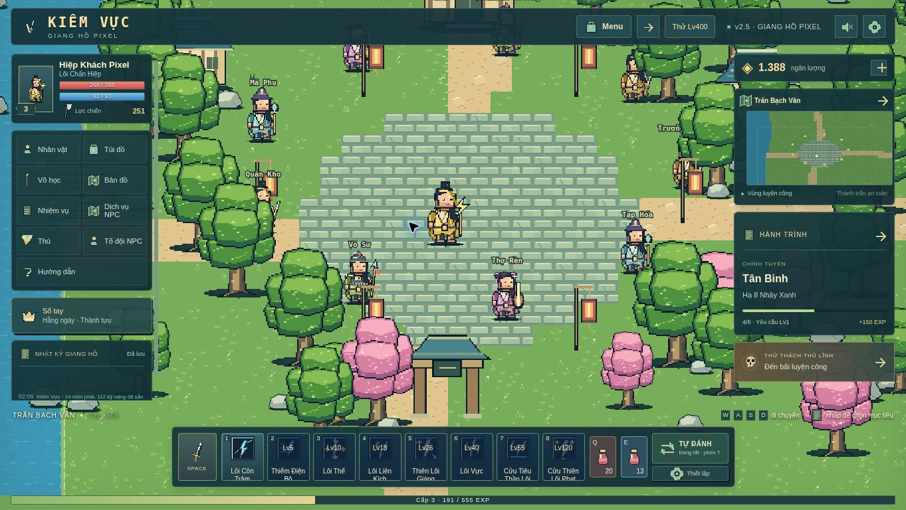
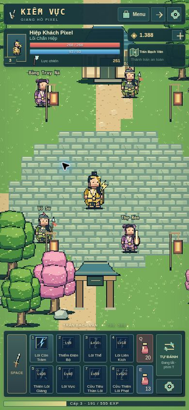
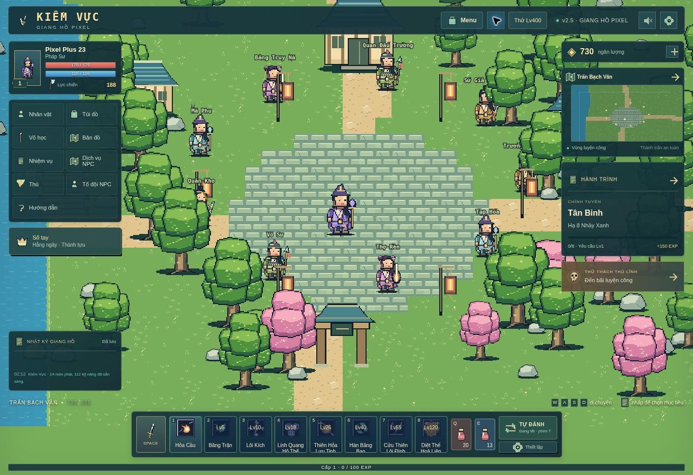

# v2.5 — Cảnh sáng, giao diện theo vùng

Bản này đổi màu trực tiếp trong bộ vẽ pixel, không dùng bộ lọc tăng sáng trên toàn màn hình. Cỏ xanh tươi, hoa anh đào hồng, nước xanh lam, đá lát sáng và nhà màu kem; sáu nhóm địa hình vẫn có bảng màu riêng. Chữ tên NPC có viền tối để đọc rõ trên nền sáng. Giảm mật độ chi tiết cỏ nhỏ để hình bớt nhiễu.

## Giao diện

- Một lưới bố cục quản lý thanh trên, cột nhân vật/chức năng, vùng thông tin chiến đấu, cột bản đồ/nhiệm vụ, thanh kỹ năng và EXP. Thanh kỹ năng có hàng riêng nên các bảng hai bên không lấn xuống.
- Trên máy tính: menu chức năng dạng ô; thông tin nhiệm vụ, bản đồ, ngân lượng và thử thách nằm trong cột phải. Hai cột cuộn được khi thiếu chiều cao.
- Trên điện thoại: thanh kỹ năng 4 × 2, nút đánh/thuốc/tự đánh tách ô; bản đồ và ngân lượng rút gọn. Nút **Menu** luôn mở được nhân vật, túi đồ, kỹ năng, nhiệm vụ, sổ tay, NPC, thú, tổ đội, auto, cài đặt và hướng dẫn.
- Màn hình ngang thấp dùng thanh 8 chiêu một hàng; bảng phụ rút gọn. Hộp thoại giữ tiêu đề và cuộn nội dung bên trong.
- Nút cạnh Menu bật/tắt chế độ thu gọn; thông báo chiến đấu xếp trong vùng giữa, tối đa hai toast. Tên chiêu nằm trên lớp hồi chiêu để vẫn đọc được.
- Camera và phép chuyển điểm chạm sang tọa độ thế giới dùng cùng tâm vùng chơi còn trống, thay cho phần trăm cố định của toàn màn hình.

14 bộ hiệu ứng / 112 chiêu và hiệu ứng lên cấp v2.4 vẫn dùng cơ chế riêng trước đó. Bản này không thêm tính năng máy chủ online.

## Kiểm tra ngày 2026-11-05

`node --test tests/*.test.js`: **59/59 đạt**. `node --check` đạt cho game và bộ vẽ pixel. HTML có 69 ID tĩnh duy nhất.

Kiểm tra trong Chrome từ bản preview đang chạy, dùng iframe đặt kích thước viewport. Đây là mô phỏng kích thước trong trình duyệt, chưa phải thử trên máy điện thoại thật.

| Viewport | Bảng chính đè nhau | Tràn ngang | Điều khiển vượt viewport |
|---|---|---|---|
| 1363 × 768 | Không | Không | Không |
| 1024 × 768 | Không | Không | Không |
| 768 × 1024 | Không | Không | Không |
| 390 × 844 | Không | Không | Không |
| 360 × 640 | Không | Không | Không |
| 844 × 390 | Không | Không | Không |
| 667 × 375 | Không | Không | Không |
| 1920 × 1080 | Không | Không | Không |

Các hình chữ nhật được so sánh: thanh trên, nhân vật, ngân lượng, bảng bản đồ, thanh chiến đấu và EXP. [Dữ liệu đo](layout-check-v2.5.json). Kiểm tra riêng bảng bản đồ nằm gọn trong cột ở 360 × 640, hộp thoại cuộn ở 667 × 375. Đã chọn Thiên Âm Cầm Sư, đặt tên, tạo nhân vật Lv1 thành công ở 360 × 640; mở các mục Menu, bật/tắt thu gọn, thử bù nhìn và tuyệt kỹ Lv400. Không thấy lỗi JavaScript của ứng dụng trong log trình duyệt; log tiện ích trình duyệt được loại riêng.

## Xác nhận trên GitHub Pages

Mã triển khai: `c1fbdc9f5b94de25fac08346a18ae29591335343`. GitHub Actions run `41953526274` hoàn thành thành công, gồm xác thực JavaScript và triển khai Pages. Tám tệp công khai đã trả HTTP 200 và SHA-256 khớp bản đã kiểm tra: [kết quả đối chiếu](live-assets-v2.5.json).

Đã tải lại URL công khai, thấy nhãn **v2.5 · GIANG HỒ PIXEL**, mở Menu → Sổ tay và bật/tắt thu gọn thành công. Đo bố cục công khai 1363 × 936 không có va chạm giữa các bảng chính, không tràn ngang hoặc vượt viewport.

