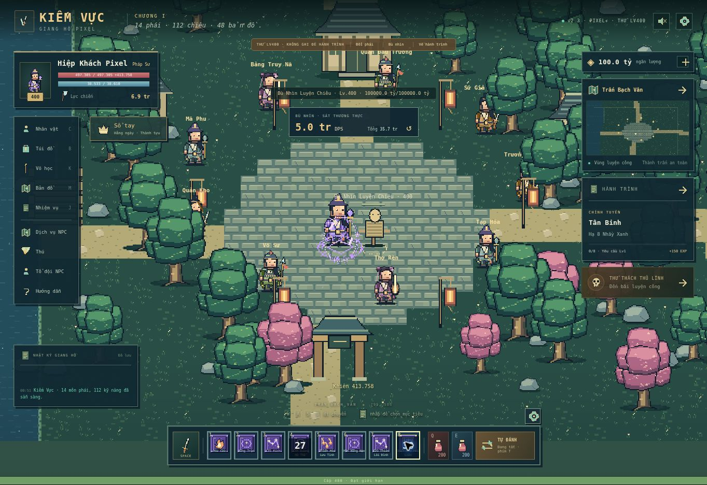
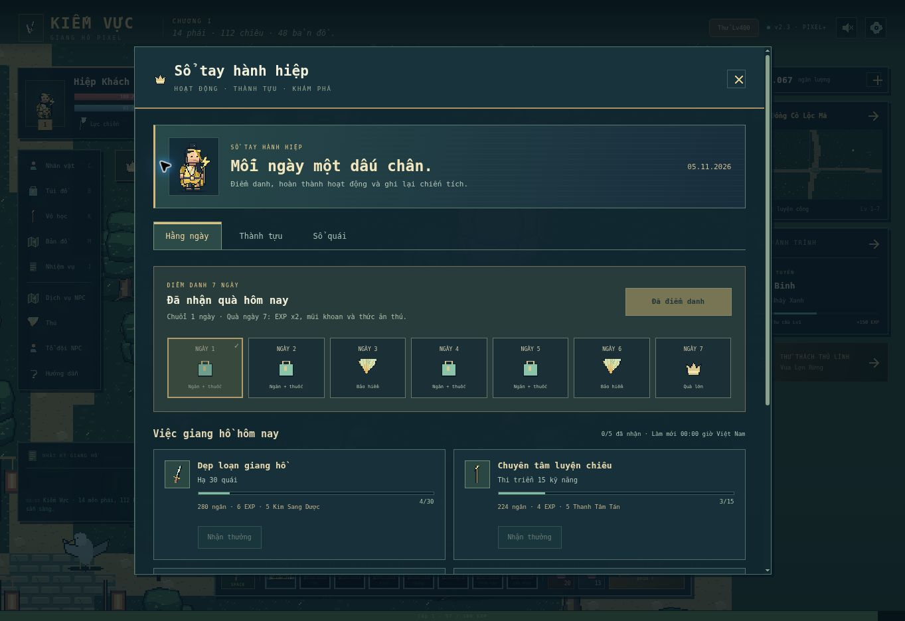

# Kiếm Vực v2.3 — Pixel+ / 05-11-2026

Bản chạy: https://caovanhanhtp2891-lab.github.io/kiemvuc/

## Hình ảnh và hiệu ứng

- Vẽ lại 14 nhân vật trên canvas sprite 56×64: áo nhiều lớp, nếp vải, giáp, dây đeo, tóc, khăn, mũ, phụ kiện và vũ khí theo phái. Có 6 nhịp bước chân, mặt lưng khi đi lên và các tư thế vung vũ khí.
- Vẽ lại tán cây nhiều lớp, thân và bóng cây, hoa/đá/rêu, đường đất, gạch và bờ nước; giữ 6 bảng màu sinh cảnh.
- Nâng 112 biểu tượng kỹ năng lên ảnh PNG 32×32, có viền và điểm sáng pixel. 14 hình phái và 112 ảnh skill khác nhau, không có ảnh lỗi trong lần kiểm tra.
- Hiệu ứng có lớp tối, màu chính và lõi sáng: vệt chém, vụn băng, lửa, sét nhánh, pháp trận, khiên, hồi phục, dư ảnh lướt, mưa đạn và tia trúng đòn. Chiêu có tên băng/hỏa/lôi/độc được chọn màu hệ tương ứng.
- Quái hiện dấu độc, đốt, làm chậm và sao choáng. Vùng nguy hiểm boss vẫn có màu cảnh báo riêng. Số sát thương nhiều đợt được gộp trong khoảng ngắn và chia làn để giảm chồng chữ.
- Canvas thế giới dùng độ phân giải hiển thị, sprite phóng gần nhất; ảnh không làm mịn. Giới hạn hạt/số nổi để tránh tăng vô hạn khi đánh nhiều mục tiêu.

## Tính năng mới

| Mục | Hành vi |
| --- | --- |
| Điểm danh | Chuỗi 7 ngày; ngày 7 có EXP x2, mũi khoan, thức ăn; bỏ ngày thì bắt đầu lại chuỗi; mỗi ngày nhận một lần |
| Hoạt động ngày | 5 mục: hạ 30 quái, dùng 15 chiêu, nhặt 10 chiến lợi phẩm, hạ 1 boss, qua 1 phó bản; có tiến độ và phần thưởng riêng |
| Thành tựu | 19 mốc cấp, quái, boss, nhiệm vụ, rèn, phó bản, đấu trường NPC, học chiêu và khám phá; nhận một lần |
| Sổ quái | 146 mẫu, tìm theo tên/cấp, lọc boss/đã hạ, số lần hạ, chỉ số và vùng xuất hiện; dẫn đường theo cấp |
| Tự đánh | Chọn ưu tiên boss/nhiệm vụ, chạy nhặt đồ, dùng chiêu, bật/tắt từng ô chiêu; chọn ngưỡng thuốc HP/MP 10–90% |
| Bù nhìn | Tổng sát thương và DPS của phiên thử; nút đặt lại; không thay đổi tiến trình hành trình |

Nhấn **H** hoặc nút **Sổ tay** để mở hoạt động, thành tựu, sổ quái. Nhấn **O** hoặc bánh răng gần thanh chiến đấu để mở thiết lập tự đánh. Trong chế độ Lv400, dùng **Bù nhìn** để xem chiêu và thống kê sát thương.

Các trường mới lưu chung trong bản JSON v2. Bản v2/v2.1/v2.2 giữ tiến trình; cờ quà ngày cũ được chuyển sang điểm danh để tránh nhận lại cùng ngày. Sổ quái bắt đầu ghi số lần hạ từ v2.3 vì bản cũ không có lịch sử theo từng loài. Đấu trường NPC không cộng quái/boss hoặc sổ quái. Chế độ thử không cộng hoạt động và khóa nhận thưởng, không ghi đè hành trình.

Ngày tính theo múi giờ Việt Nam, phụ thuộc đồng hồ thiết bị. Đây vẫn là game chơi đơn lưu trên trình duyệt; không phải hệ thống thưởng hoặc tài khoản được xác thực trên máy chủ. Các phần online đã liệt kê trong README vẫn chưa có.

## Kiểm tra

- **49/49 bài kiểm tra Node đạt**: giữ toàn bộ kiểm tra cũ và thêm thưởng một lần, lưu/nạp, đổi ngày, chuỗi 7 ngày, nhập dữ liệu lỗi, cô lập demo, sự kiện chiến đấu thật, tùy chỉnh chiêu/thuốc/boss, tổng sát thương và reset.
- Trình duyệt: đã chọn và dùng 8 chiêu qua đủ 14 phái; không ghi nhận lỗi JavaScript từ game trong lượt thử. Kiểm tra đủ 112 ảnh skill 32×32, 112 nguồn ảnh riêng, 14 ảnh nhân vật riêng; không có ảnh hỏng.
- Đã tạo nhân vật thật trong bản preview, hạ quái và thấy số lần trong sổ; nhận điểm danh và thành tựu; tải lại vẫn giữ ngưỡng HP 70%, ô chiêu 8 bị tắt và phần thưởng đã nhận.
- Viewport 390×740: nút tạo nằm trong khung, tâm nút trỏ đúng `startBtn`; tạo **Pixel Mobile 23 / U Minh Liêm Sư / Lv1** thành công. Sổ tay và tự đánh mở được.
- Sổ tay: khung 390×740 nằm ở `[8,382,8,732]`; khung 844×390 nằm ở `[18,826,22.25,353.75]`. Cả hai cuộn được trong cửa sổ. Đã sửa nút tự đánh bị lớp điều khiển che và cửa sổ bị lệch ở khung thấp.
- Các lượt viewport không thay thế thử Cốc Cốc hoặc điện thoại thật.

