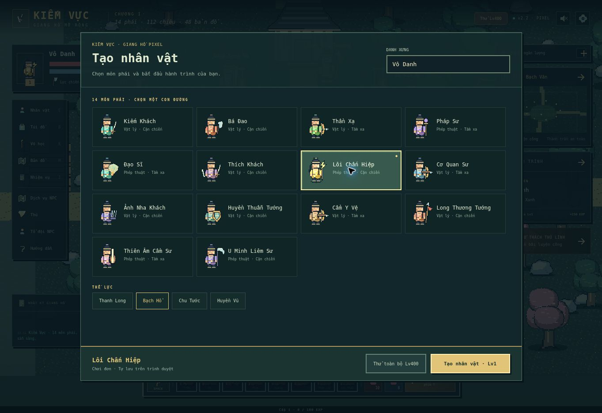
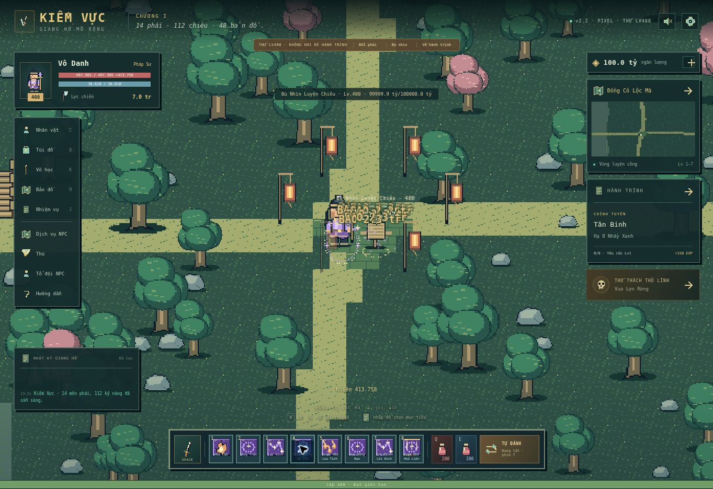

# Bản pixel v2.2 — 04/11/2026

Bản chạy: https://caovanhanhtp2891-lab.github.io/kiemvuc/

## Sửa tạo nhân vật

Ảnh báo lỗi cho thấy phần nút bắt đầu bị cắt ở dưới danh sách 14 phái: khung có giới hạn chiều cao nhưng `overflow: hidden` khóa cuộn. Bản mới chia màn hình thành đầu khung, danh sách cuộn riêng và chân khung cố định. Chiều rộng cũng được chặn theo viewport, tránh grid tự nở rộng ngoài màn hình điện thoại.

- Nút **Tạo nhân vật · Lv1** luôn nằm ngoài vùng danh sách cuộn.
- Chọn phái/thế lực cập nhật tại chỗ; giữ tên đang nhập và vị trí cuộn.
- Nhấn Enter ở ô danh xưng có thể tạo nhân vật.
- Bắt đầu đúng cấp 1, đúng phái, tên và thế lực; lưu tiến trình như trước.

## Bộ đồ họa mới

`dist/pixel-art.js` vẽ sprite trực tiếp trên lưới pixel nguyên, lưu đệm bitmap và sinh ảnh PNG trong bộ nhớ. Không cần ảnh bên ngoài hoặc tải thêm gói hình. Đây là bộ hình mới của dự án.

- 14 sprite phái với màu áo và vũ khí riêng; có khung bước chân và tư thế đánh.
- 112 biểu tượng kỹ năng raster 24×24, phân biệt phái/chiêu, có hình cho lửa, bùa, đạn, kiếm, khiên, hồi máu, triệu hồi, sét, mưa đạn và tuyệt kỹ.
- Các họ quái, boss, NPC, thú, bù nhìn, vật phẩm, cây, nhà, cổng, đèn và nền bản đồ được chuyển sang pixel.
- Hiệu ứng chém, đạn, nổ, sét, vòng phép, cảnh báo, khiên, hồi phục, lướt và lên cấp dùng nét pixel.
- Canvas màn chơi chạy ở nửa kích thước hiển thị, phóng gần nhất; giao diện ảnh dùng `image-rendering: pixelated`. Không dùng bộ lọc làm mờ để giả sprite.
- Khung giao diện vuông, font hệ thống, bỏ phụ thuộc tải font Google.

## Kiểm tra

- **35/35 bài kiểm tra Node đạt**, gồm hồi quy tạo đúng nhân vật cho cả 14 phái, cùng toàn bộ luật và engine từ v2.1.
- Đã tạo Lôi Chấn Hiệp tên **Lôi Pixel** trên trình duyệt và tải lại: tên/phái/cấp giữ đúng.
- Thử giao diện trong iframe viewport **920×620** và **390×680**: nút tạo nằm hoàn toàn trong cả chiều ngang/dọc, tâm nút trỏ đúng `startBtn`; tạo và vào game được ở cả hai khung.
- Khung máy tính: nhân vật **Pixel Desktop / Lôi Chấn Hiệp**. Khung điện thoại: **Pixel Mobile / U Minh Liêm Sư**.
- Đã thử thi triển 8 kỹ năng của mỗi phái trên bù nhìn và kiểm tra renderer; không ghi nhận lỗi JavaScript của game trong lượt thử.
- Xác nhận **112/112 ảnh** biểu tượng kỹ năng được tải, kích thước gốc 24×24, **112 nguồn ảnh riêng**, không có ảnh hỏng.

Thử khung điện thoại là kiểm tra viewport của trình duyệt, chưa thay thế kiểm tra Cốc Cốc hoặc điện thoại thật. Các bản lưu v2/v2.1 vẫn dùng khóa lưu cũ. Bộ ảnh và engine này được tự viết; không phải tài nguyên gốc Chiến Hồn.

