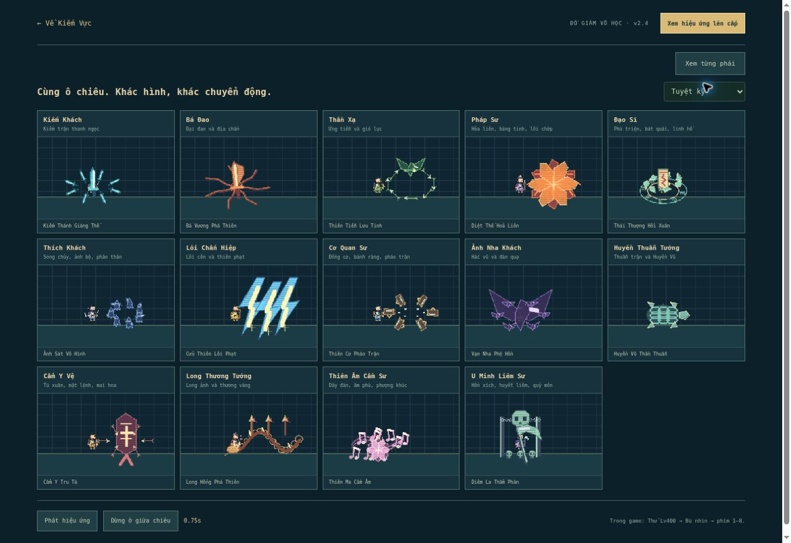
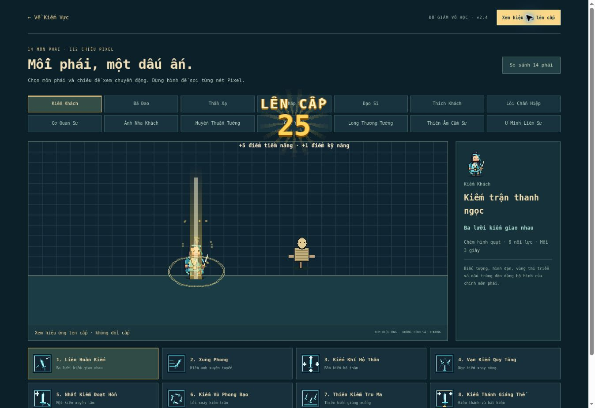

# v2.4 — Bộ chiêu riêng từng phái / 05-11-2026

Game: https://caovanhanhtp2891-lab.github.io/kiemvuc/

Đồ giám: https://caovanhanhtp2891-lab.github.io/kiemvuc/effects.html

## Thiết kế 14 phái

Mỗi phái có 8 bố cục được đặt tên và viết riêng trong `dist/school-fx.js`. Các phái dùng chung công cụ chấm/đường/polygon trên lưới Pixel; bố cục, vật thể, quỹ đạo và hình tuyệt kỹ khác nhau, không chỉ đổi bảng màu. Không thay đổi luật sát thương, hồi chiêu, nội lực, mở khóa, cấp độ hoặc bản lưu.

| Phái | Ngôn ngữ hình | Tuyệt kỹ |
| --- | --- | --- |
| Kiếm Khách | Kiếm sáng, ngự kiếm, kiếm ảnh, thiên kiếm | Kiếm thánh giữa bát kiếm |
| Bá Đao | Đại đao, thiết bích, cuồng nộ, rạn đất | Cự đao bổ và chấn địa |
| Thần Xạ | Ưng tiễn lông vũ, gió, mắt ưng | Ưng tinh và vòng thiên tiễn |
| Pháp Sư | Hỏa cầu, ngục băng, sét phép, khiên lăng kính, thiên thạch | Hỏa liên nở nhiều tầng |
| Đạo Sĩ | Linh phù, lá xuân, linh hồ, bát quái, phong ấn | Bát quái hồi xuân và đại phù |
| Thích Khách | Song chủy, phi đao, khói, ảnh bộ, phân thân | Phân thân bao vây liên kích |
| Lôi Chấn Hiệp | Lôi côn, điện giáp, lôi vực, cột sét | Ba cự lôi thiên phạt |
| Cơ Quan Sư | Liên nỗ, bom, đồng giáp, mìn, bánh răng, nòng pháo | Sáu pháo cơ quan vây trận |
| Ảnh Nha Khách | Nha trảo, lông vũ, cánh đen, đàn quạ | Quạ khổng lồ và đàn quạ nhỏ |
| Huyền Thuẫn Tướng | Khiên lục giác, quân kỳ, tường thuẫn, hàng thương | Huyền Vũ với mai lục giác |
| Cẩm Y Vệ | Tụ tiễn, tú xuân đao, mật lệnh, mai hoa châm, lưới đỏ | Đại mật lệnh và tiễn trảm quyết |
| Long Thương Tướng | Thương vàng, hồi mã thương, long ảnh, thương trận | Kim long uốn mình và hàng thương |
| Thiên Âm Cầm Sư | Dây đàn, khuông nhạc, âm phù, phượng khúc | Đại nhạc phổ Thiên Ma |
| U Minh Liêm Sư | Móc hồn, lưỡi liềm, đầu lâu, hồn xích, bách quỷ | Quỷ môn Diêm La và cự liêm |

- 112 biểu tượng PNG 32×32 được vẽ lại bằng các vật thể của từng phái; mỗi ô có bố cục riêng và nét vẽ ở trung tâm.
- Đạn có hình riêng: tiễn lông ưng, kim Cẩm Y có dải đỏ/mai hoa, hỏa cầu/thiên thạch, phù giấy, phi đao, lông quạ, đạn cơ quan, âm phù/phượng khúc, móc liềm.
- Mỗi lượt thi triển tạo một mô tả hình bất biến theo ID chiêu. Mô tả đi theo đạn, liên kích, đợt rơi, đòn chém trễ, hiệu ứng độc/đốt và linh thú triệu hồi; tung chiêu tiếp theo không đổi hình của chiêu đang bay.
- Hiệu ứng hộ thể/tăng chỉ số có bố cục riêng theo phái và kéo dài cùng thời hạn buff.
- Các đường cảnh báo của boss giữ màu cảnh báo riêng.

## Lên cấp theo mẫu Chiến Hồn

Tham chiếu: https://chienhon.top/ — đã đọc lại HTML/client công khai ngày 05/11/2026. Bản tham chiếu được giữ ngoài repository để phân tích; không đưa bundle gốc vào dự án.

Các lớp đã đối chiếu và dựng lại bằng mã Pixel độc lập:

| Lớp | Thông số quan sát / áp dụng |
| --- | --- |
| Cột vàng có lõi trắng | Cao 260, rộng gốc 34; mờ dần trong 1,4 giây |
| Vòng vàng quanh chân | Bán kính 5 → 90, dẹt 0,55; nở trong 0,9 giây |
| Hạt vàng bay lên | 26 hạt, xuất phát trong khoảng ±20; bay lên trong 1 giây |
| Bảng cấp | “LÊN CẤP”, số cấp lớn ở giữa, dòng điểm bên dưới; nằm ở 30% chiều cao màn hình |
| Chuyển động bảng | Chữ bật từ nhỏ lên lớn, giữ khoảng 2 giây, mờ 0,52 giây |
| Tia phía sau | Vùng 320×320, xoay khoảng 90° trong 2,4 giây |

Đây là bản dựng lại hình và nhịp theo tham chiếu; nét sáng và tia được raster hóa để hợp đồ họa Pixel của Kiếm Vực. Các nguồn tăng cấp dùng chung một đường hiển thị: EXP chiến đấu, nhiệm vụ, thưởng hoạt động, EXP offline. Đạt nhiều cấp cùng lúc hiển thị cấp cuối và tổng điểm được cộng.

## Cách xem

1. Mở **Võ học (K) → Đồ giám hiệu ứng**, hoặc mở link đồ giám ở đầu trang.
2. Chọn 1 trong 14 phái, rồi 1 trong 8 chiêu. Có nút phát/tạm dừng và dừng giữa chiêu.
3. **So sánh 14 phái** đặt các phái cạnh nhau; chọn cùng ô chiêu để đối chiếu hình và chuyển động.
4. **Xem hiệu ứng lên cấp** chạy cùng bộ vẽ và bảng cấp; ở trạng thái dừng, giữ khung giữa để xem chi tiết. Đây là xem hình, không đổi cấp hoặc điểm.
5. Trong game, **Thử Lv400 → Bù nhìn → phím 1–8** để đánh thật. Nút **Xem lên cấp** ở chế độ thử không đổi tiến trình.

## Kiểm tra

- GitHub Pages đã triển khai `f5407e0` thành công. Đã mở bản công khai, xác nhận nhãn v2.4, liên kết từ Võ học, mô tả hình từng chiêu, bảng so sánh 14 phái và bảng lên cấp; không có lỗi JavaScript của ứng dụng trong lượt xác nhận.
- **59/59 kiểm tra Node đạt**. Giữ toàn bộ kiểm tra luật/engine trước đó, gồm tác dụng thực của 112 chiêu.
- Kiểm tra đủ 112 mô tả chiêu, 8 bố cục/phái; vẽ ở ba thời điểm không có tọa độ không hợp lệ.
- Bỏ qua màu khi băm hình học: đủ 14 tuyệt kỹ khác nhau; 8 bố cục của từng phái khác nhau ở hai thời điểm.
- Raster hóa thật biểu tượng trong bộ kiểm tra: 112 ảnh riêng, mỗi ảnh có nét ở trung tâm. Trình duyệt xác nhận đủ 112 nguồn PNG, kích thước 32×32, không có ảnh hỏng.
- Trình duyệt: đã xem cả 8 ô chiêu trên bảng so sánh 14 phái, tức đủ 112 bố cục; không ghi nhận lỗi JavaScript của game.
- Trong trận: đã dùng chiêu 1, chiêu 4 và tuyệt kỹ của các phái (nhóm đầu thử chiêu 1 và tuyệt kỹ), qua đủ 14 phái; không ghi nhận lỗi JavaScript của game.
- Nhận EXP offline thật trên preview: nhân vật từ Lv1 lên Lv2, bảng hiện cấp 2 và +5 điểm tiềm năng / +1 điểm kỹ năng. Có kiểm tra tự động cho lên cấp từ EXP và nhiệm vụ.
- Đồ giám ở iframe 390×740 và 844×500: chiều rộng nội dung bằng viewport khả dụng (375 và 829 do thanh cuộn), không tràn ngang; chọn phái/chiêu và so sánh 14 phái được trên khung điện thoại. Chưa thay thế thử trên điện thoại thật.

